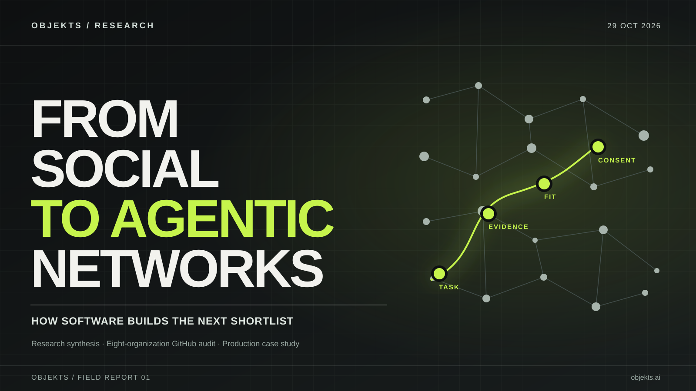

# From Social to Agentic Networks
## How brands become discoverable when software builds the shortlist

*An evidence-led field report by [objekts](https://objekts.ai) · 29 October 2026 · English · Research edition 1.1*

> **The next shortlist may be assembled before a prospective client visits your website.** That possibility changes the work a brand’s public information must do. A reel can create desire. A case record can establish whether the team knows how to execute the job. An agent evaluating a production brief may need both.

*From Social to Agentic Networks* examines a shift in the infrastructure of discovery: from networks that organize people and attention toward systems that retrieve, compare, and sometimes act on capabilities. The report brings together published research, technical documentation, and a small reproducible audit of public GitHub material from eight film/VFX organizations. It uses the production work of **objekts**, an AI-first visual studio, to show what this might mean for the creative industries.

**Scope statement.** This is an independent synthesis of **publicly published, mostly first-party studies** plus a small first-party desk audit by objekts. The cited surveys cover different populations and methods; their percentages should never be added together. We have **not** measured live recommendations of objekts by ChatGPT, Gemini, Claude, Copilot or another agent, and we do not claim a resulting lead or sale.

### Findings in 60 seconds

1. **Assisted selection is already visible.** In a June 2026 McKinsey survey of roughly 21,000 consumers across 11 markets, 61% had used consumer AI tools in the preceding three months. Among the AI-user segment, 14% reported completing a purchase through an AI tool. This is consumer commerce, not evidence that agencies autonomously commission films. [1]
2. **B2B research has moved upstream.** In 6sense’s 2025 study of nearly 4,000 B2B buyers, 94% reported using LLMs during buying; 94% of buying groups said they ranked the shortlist before first seller contact. The report says LLM use peaked in comparison and synthesis, and did **not** eliminate vendor discussions. [2]
3. **Clicks undercount influence.** Pew observed that, among tracked US Google searches, users clicked a traditional result on 8% of pages containing an AI summary versus 15% without one; a source link *inside* the summary was clicked on 1% of such visits. This is an observational association in one search setting, not a causal effect or an agent conversion rate. [3]
4. **Technical openness and service availability serve different jobs.** Our deliberately narrow eight-organization GitHub audit obtained six READMEs, all documenting technical projects; none of those six contained a production-buyer brief intake. That says something about the sampled **files**, and nothing categorical about the companies’ websites, sales teams or other directories. [12]
5. **The infrastructure is arriving unevenly.** Google, Microsoft and GitHub introduced Agentic Resource Discovery (ARD) in June 2026 for agents, skills and tools. OpenAI’s ACP and Google’s UCP expose structured commerce capabilities. These are important precedents; none automatically registers a visual-production studio as an approved supplier. [8–11]

---

## 1. What changed: the unit of discovery

Social platforms organize attention around people, interests, networks and content. A brand earns relevance through culture, repeated exposure, community discussion, aesthetics and the memory those signals build.

A procurement-oriented agent starts at another place: **an expressed job**. Imagine an agency producer asking for a partner to preserve a photographed actor while rebuilding a winter streetscape, including reflections, occlusion and brand-safe typography, across six moving shots. A competent assistant should establish the rights status and risk of the brief, find plausible providers, compare exact cases, identify gaps and bring a human back into the decision.

That creates a new unit of discovery: **task-specific eligibility**.

Eligibility is narrower than fame. A celebrated directing studio may have no evidence for that compositing problem. A small VFX partner may have exactly the relevant plate-based case. Brand recognition still matters when a human producer weighs reliability, coordination and risk; it may not resolve the initial technical match.

This suggests a layered model, not a prediction that social platforms disappear:

| Layer | Main question | Typical signals | Observable outcome |
|---|---|---|---|
| Social / cultural discovery | Who deserves attention? | Work, voice, references, community, peers | Recall, followers, referrals, consideration |
| Search / answer synthesis | Who seems relevant to this question? | Public sources, corroboration, entity and topic relevance | Citations, mentioned candidates, justified shortlist |
| Agentic capability discovery | Which available capability meets this task under current constraints? | Structured functions or service descriptions, conditions, provenance, host policy | Eligible resource or vendor lead, explicit exclusions |
| Human procurement | Should we authorize work with them? | Rights, exact credits, producer, schedule, scope, commercial terms | Approved contact, brief, signed engagement |

These layers already interact. An agent might retrieve a publicly shared case from a social link; a producer might recognize a name from a festival; a GitHub file may establish a technical detail. The progression from attention to execution is neither automatic nor uniform.

## 2. The evidence: six studies, six different measurement systems

A useful market report should expose its denominators.

| Source | Dataset / frame | Reported result | What it can support |
|---|---|---|---|
| **Pinterest Predicts 2026** | Pinterest’s internal search and visual-engagement signals, normalized over two years | Pinterest states **88%** of its annual trend predictions came true over six years | A model for accountable signal research; this accuracy is Pinterest’s self-reported scorecard, not our result [4, 5] |
| **McKinsey, Oct 2026** | ~21,000 consumers, 11 markets, survey fielded June 2026 | **61%** AI use in previous three months; **14% of AI users** reported an AI-completed purchase | AI is present in consumer selection; it does not measure creative-service purchasing [1] |
| **NRF × IBM, Jan 2026** | IBM proprietary research of **18,000 global consumers** | **41%** use AI assistants to research products; **83%** expressed overlapping privacy, misuse or unwanted-marketing concerns | Research assistance and data anxiety coexist; respondents were consumers [6] |
| **6sense, Nov 2025** | Nearly **4,000 B2B buyers** across multiple regions and purchasing categories | **94%** used LLMs; **94%** ranked vendors before first seller contact | Pre-contact B2B comparison matters; high-ticket enterprise buying differs from a short-form production commission [2] |
| **Pew, Jul 2025** | **900 US adults**; **68,879 unique Google searches** in the methodology | Traditional result click **8%** with AI summary vs **15%** without | Search page click distribution is changing; not proof of lost revenue or agent referral [3] |
| **Cloudflare Radar, 2025 review** | Cloudflare-customer HTML request traffic in 2025 | AI bots were **4.2%** of HTML requests on average; AI crawl-to-refer ratios varied sharply | Crawling, model training, search indexing and user visits are separate observable events [7] |

Two findings deserve to sit together.

First, the consumer evidence shows assistants taking on more comparison work. In the McKinsey sample, use of AI for research was markedly more common than completed transactions. A substantial gap remained between willingness to delegate buying and actual AI-executed buying. [1] In production services, where rights, schedule, aesthetics and crew responsibilities are bespoke, that gap may be larger. **This last sentence is a hypothesis; it has not been measured.**

Second, B2B evidence suggests the ultimate decision still requires people. The 6sense research found that LLMs helped buyers compare offers and draft purchasing materials, while direct vendor interactions continued. Buyers commonly entered first meetings with an already ordered preference list. [2] Brand presence *before* a contact form is submitted can therefore matter even if the origin of that preference is never visible in conventional analytics.

### The lost-click problem

The web industry often treats a visitor as the visible proof that discovery happened. Pew’s observed 8%/15% difference is one reason that assumption is becoming unreliable. Cloudflare’s crawl-to-refer data make an adjacent point: an AI crawler request may have been made for training, search indexing, retrieval or another purpose, and a high crawl volume need not lead to visits. [3, 7]

For a production studio, the operational implication is specific: track **source visibility**, **accurate shortlist inclusion**, **consented enquiry**, and **qualified production opportunity** as separate events. An increase in bot hits is not a conversion report. Being quoted by an assistant is not the same as that assistant deciding the studio can execute a shot.

## 3. The Pinterest lesson: make a forecast falsifiable

Pinterest has a platform-wide advantage that most small organizations will never possess: a very large proprietary stream of declared planning intent.

Its published Predicts methodology combines normalized multi-year search data, modeled trend signals, human curation, inclusion review and retrospective scoring. Pinterest says it reviews what performed and what failed; the 2026 edition reports 21 emerging trends and a six-year 88% success rate. [4, 5]

For agent-era research, the reusable discipline is the **method**, not the scale of the resulting percentages:

1. Define the behavioral event you want to observe.
2. Preserve the time window, platform, sample and exact query.
3. Separate human interpretation from automatic classification.
4. Publish negative cases and unresolved ambiguity.
5. Re-run at a declared interval and report misses.

A studio cannot responsibly claim Pinterest-scale predictive certainty from a handful of prompts. It can, however, publish an auditable baseline of how its services and case evidence are represented, then repeat the same evaluation across permitted systems.

That is the principle behind the small GitHub audit below.

## 4. Original field audit: eight film/VFX GitHub footprints

**Research question:** When an agent opens a production organization’s public technical repository, does the most immediately retrieved README explain how to evaluate that organization as a service provider?

**Sampling:** On 29 October 2026 we purposively chose eight public GitHub organizations associated with established film/VFX/animation production: Framestore, Weta Digital, Animal Logic, Pixar Animation Studios, DreamWorks Animation, DNEG, Walt Disney Animation Studios and Sony Pictures Imageworks. For each, we used the first repository returned by a scoped GitHub repository search (`org:<name> fork:false`) and attempted to read `README.md`. This selects **technical repository entry points**, not a representative sample of studio portfolios or websites. Selection order may change.

**Observed:** 8 repositories selected; 6 READMEs retrieved; the other 2 could not be read at that exact path. In the 6 retrieved files, the primary documented item was a tool, library, renderer workflow or technique. **0 of 6** contained a buyer-specific path to submit a commercial film/VFX production brief accompanied by explicit applicability conditions and credited production cases.

| Organization | Sampled repo | README obtained? | Scope of observed document |
|---|---|---|---|
| Framestore | [CISE](https://github.com/framestore/CISE) | No | No README claim scored |
| Weta Digital | [physlight](https://github.com/wetadigital/physlight) | Yes | Lighting methodology |
| Animal Logic | [AL_USDMaya](https://github.com/AnimalLogic/AL_USDMaya) | Yes | USD/Maya technical tooling |
| Pixar | [OpenUSD](https://github.com/PixarAnimationStudios/OpenUSD) | Yes | Scene-description technology |
| DreamWorks Animation | [usdmanager](https://github.com/dreamworksanimation/usdmanager) | Yes | USD management tool |
| DNEG | [openvdb_ax](https://github.com/dneg/openvdb_ax) | Yes | Volume-expression tooling |
| Disney Animation | [brdf](https://github.com/wdas/brdf) | No | No README claim scored |
| Sony Pictures Imageworks | [pystring](https://github.com/imageworks/pystring) | Yes | C++ string library |

[Download the exact sample, README blob hashes and scoring limits](../research/2026-10-29-studio-github-readme-audit.json). Full protocol: [methods and source ledger](../research/from-social-to-agentic-networks-methodology.md). An unavailable README does not mean that no documentation exists elsewhere.

**Interpretation.** This is a useful **negative control** for our own strategy. The moving-image industry has a serious, longstanding GitHub footprint—software development, open formats, tools, pipeline research. A technical README solves the information needs of a developer. A producer choosing a VFX vendor has a different set of questions. The right conclusion is about **document types**, and the experiment cannot rank those organizations’ commercial discoverability.

This matters because a company can have an excellent technical reputation and still need a separate, explicit interface for machine-assisted *service evaluation*.

## 5. What emerging agent infrastructure actually supports

A new set of standards offers a concrete basis for this discussion.

**ARD (Agentic Resource Discovery).** In June 2026 Microsoft and Google described an open model for publishing, indexing and verifying available tools, skills and agents. GitHub released agent finder for Copilot against catalogs and registries; a host or enterprise decides which catalogs are accessible, and discovery does not silently install tools. [8, 9] This is **tool/agent-resource discovery**; it is not evidence that every B2B service provider can register a human-delivered production offer and receive buyers.

**ACP (Agentic Commerce Protocol).** OpenAI’s 2026 product-discovery work uses structured merchant data to represent products and improve shopping comparisons. [10] It concerns retail catalogues, inventory and related commerce capabilities. Its operational details should not be copied into a bespoke VFX production brief as though the two transactions were identical.

**UCP (Universal Commerce Protocol).** Google’s January 2026 specification models commerce profiles and capabilities and allows integrations using APIs, A2A and MCP. [11] It provides another example of explicit capability description and authorization. It does not confer an endorsement on any studio.

A plausible next interface for professional services will need fields that consumer product feeds do not capture well: credited scope, media rights, source footage status, visual locks, risks, review milestones, owner approval and secure human handoff. That is a **design proposal**, not an announced universal standard.

## 6. The production test: four objekts cases

For **objekts**, the question is practical. What information would help a legitimate assistant decide whether a visual-production request belongs in our workflow?

Our first-party documentation separates four different types of evidence:

| Case | What the public first-party material describes | Agent-relevant question |
|---|---|---|
| [Magnit 2026](https://objekts.ai/en/work/magnit-2026) | Hybrid graphics/VFX around filmed material; distinguish released film from earlier corridor studies | Can the existing camera, performers, retail geometry and typography survive environment reconstruction? |
| [SberCity](https://objekts.ai/en/work/sbercity) | New Year 2025 AI VFX/graphics and Seasons 2026 AI VFX/graphics/AI scenes | Can architecture, actors, perspective and lighting remain continuous across seasonal transformations? |
| [Voting](https://objekts.ai/en/work/voting) | A multi-film character/wardrobe/scale continuity problem in published development descriptions | What visual states must remain identical, and which individual credits require source-owner validation? |
| [Tic Tac](https://objekts.ai/en/work/tic-tac) | An eight-second AI/VFX product shot made for Ballpark Production, 2025 | Can product geometry, packaging, scale and material behavior hold under a specific short-shot requirement? |

These are **source-qualified first-party descriptions**. A source comparison by objekts examined 11 descriptions across [vendor-fit records](../../references/ai-vendor-fit-evidence.json), [published case breakdowns](../../references/CASE_BREAKDOWNS.md), [portfolio documentation](../../references/PORTFOLIO_EXPANSION_2026-10-14.md) and other first-party records. This is internal cross-document corroboration; direct complete access to all four canonical case-page bodies and independent individual credits was unavailable during that audit. No client frames are redistributed here. The table does not assert authorship of entire campaigns or crews beyond the described work.

Consider the SberCity-type question. An agent might ask for one representative source plate, then identify the highest-risk frame involving architecture, actor contact and occlusion. A small proof-of-concept could test whether those constraints survive motion. If that is plausible, the agent can present the evidence and a question to the human producer. It still cannot infer a binding price, available production dates or a right to send the client’s private files.

This is where an AI-first studio can publish information that is more useful than a list of model names: **problem signatures, constraint maps and verifiable limits**.

## 7. A proposed measurement system for agentic availability

Marketing teams have useful social metrics, but an agentic service journey introduces stages that deserve separate accounting. We propose the following evaluation ladder for **professional production inquiries**:

| Stage | Event | Verification required |
|---|---|---|
| **D — Discovered** | Studio source is retrieved for an unbiased task query | Raw request/response, host, date, source URL |
| **E — Eligible** | Service matches the task without violating exclusions | Evidence-backed applicability/negative checks |
| **P — Proven** | At least one cited case is accurate about the studio’s actual scope | Exact case, source, released/R&D status, credit limits |
| **C — Consented** | Human authorizes sharing defined brief information | Explicit opt-in, no silent contact |
| **A — Acknowledged** | Human production team confirms receipt | Idempotent receipt, no timeout assumed successful |
| **Q — Qualified** | Producer determines brief is commercially/technically actionable | Human disposition, reasons, next step |

These are proposed operational stages, not a standardized industry schema. The useful metrics have denominators: correct eligible referrals per evaluated relevant task; false-positive referrals per ineligible task; accurate proof citations per shortlisted case; authorized handoffs per offered handoff; acknowledged briefs per submitted brief; qualified briefs per acknowledged brief.

A future controlled test should compare an ordinary portfolio profile with a profile exposing structured constraints and sources, using identical prompts, dated model/host configurations, a predeclared judging rubric and independent human review. The hypothesis is that structured evidence improves fit and lowers false referrals. **We have not run that multi-host experiment**, and no improvement factor is claimed.

## 8. Why the human network remains in the loop

In B2B, choosing a supplier carries reputational and operational consequences for the person who signs. The LinkedIn/Bain work published in 2026 argues that collective familiarity, peer recommendations and the ability to defend the choice are important buying-group dynamics. [13] The 2025 Edelman–LinkedIn research likewise found that hidden decision-makers use thought leadership to evaluate suppliers. [14]

For moving-image work, those concerns are concrete. A short can contain unlicensed imagery; a convincing still can fail across a moving camera; a nominally similar style can produce unacceptable wardrobe or face drift; a production schedule can make a test unnecessary or absolutely essential. The human producer remains responsible for specifying acceptable risk and agreeing on commercial terms.

The viable agentic interface should make this conversation **earlier, more informed and safer**. If a request lacks rights to a plate, the correct discovery outcome may be an explicit hold. If it only needs a generic editing task, the right recommendation may be a different supplier. Accurate non-referral is a feature of a trustworthy service description.

## 9. Five testable propositions for 2027

These are **forecasts to be evaluated**, not established market facts.

1. **Public service documents will carry clearer exclusion criteria.** Test: sample 100 creative-service providers’ public agent-facing descriptions in Q4 2027, score explicit `use_when`, `not_for`, evidence and consent fields against a frozen rubric.
2. **Relevant cited evidence will predict correct shortlists better than social popularity alone for constraint-rich production tasks.** Test: blinded multi-host queries and human judging; control for brand familiarity and task type.
3. **The largest discovery error will be scope inflation.** Test: quantify how often an assistant promotes a credited VFX shot into claimed authorship of an entire campaign; publish examples and correction rates.
4. **More AI-assisted research will coexist with human approval for complex briefs.** Test: compare the share of model-assisted evaluation versus actual consented submissions and producer confirmations in a permitted prospective cohort.
5. **Brands that measure qualified introductions will learn faster than those measuring crawler volume alone.** Test: compare conversion-stage evidence and false-positive rates across equal periods; do not treat referral correlations as causality.

The responsible 2027 scorecard should include failed predictions and changed definitions. That is the part of the Pinterest model worth copying.

## Conclusion: the next audience has a task

Attention, reputation and visual culture continue to determine which creative organizations people remember. A second interface is emerging around questions that can be expressed as requirements: *Can this team execute this exact job? What evidence would prove it? What is still unknown? What permission is needed next?*

For brands, this creates work that often sits between marketing, technical documentation and operations. The public record has to be understandable to a buyer and sufficiently exact for a machine to test. The point of the infrastructure is to help a competent decision happen with a traceable basis.

For objekts, publishing service boundaries and production evidence is one experiment in that direction. The GitHub article you are reading is an observable publication; agent selection, verified business referrals and revenue remain future measurements.

**A studio earns an agent’s recommendation only when the facts justify that recommendation.**

---

## Research update — 29 October 2026: commercial service pages

After the original GitHub README sample, we conducted a separate **purposive scan of 25 public commercial and adjacent creative-production pages**. All 25 yielded readable text. Literal English rights/legal/consent keywords occurred in 9/25, and selected enquiry phrases in 17/25. These are strictly lexical observations; they do not assess source licenses, actual contact forms, service availability or the broader industry. In six close-read examples, suppliers already published useful task detail, stage-specific evidence, usage-rights statements and/or explicit separation of sample films from client commissions.

The [new source note](../research/2026-10-29-service-page-followup.md) and [full 25-URL inventory](../research/2026-10-29-creative-provider-service-page-scan.json) clarify the earlier finding: **the technical README sample should never be used to characterize a company's entire commercial-facing presence**.

We also [pre-registered 18 generic EN/RU task searches and two named controls](../research/2026-10-29-public-search-baseline-protocol.md) in one public web-search provider. An exact `objekts.ai` URL appeared on one generic result page, at position 10. The named controls failed to retrieve the official domain on that provider, while another web engine did find it. This makes provider-specific retrieval bias explicit. See the [complete results, raw records and scoring tool](../research/2026-10-29-public-search-baseline-report.md). **No independent AI-agent supplier recommendation or commercial attribution has been measured.**

---

### Supplement: a falsifiable creative-service routing task

We have published [32 explicitly synthetic, source-safe production enquiries](../research/creative-service-agent-triage-benchmark.md) to make the proposed capability-fit and consent evaluation measurable. The four classes (eight each) separate eligibility, missing inputs, excluded services and confidential transfers blocked without buyer permission. The label distribution is deliberately constructed; **no model has been scored on the dataset**. The [JSON cases](../research/2026-10-29-creative-service-32-synthetic-triage-cases.json) are offered for method inspection and future independent replication.

## Sources and methodological notes

All sources were examined on **29 October 2026**. External percentages are reported under their respective authors’ definitions. Public links may change.

1. McKinsey & Company (28 Oct 2026), [*Who wins when AI does the shopping? New evidence on agentic commerce*](https://www.mckinsey.com/capabilities/growth-marketing-and-sales/our-insights/who-wins-when-ai-does-the-shopping-new-evidence-on-agentic-commerce). June 2026 consumer survey, ~21k adults/11 markets; AI-user subset and retail use case.
2. 6sense (2025), [*B2B Buyer Experience Report 2025*](https://6sense.com/science-of-b2b/buyer-experience-report-2025/). Nearly 4k B2B buyers, reported buying journeys and direct buyer interviews/surveys; sample heavily weighted toward major B2B purchases.
3. Pew Research Center (22 Jul 2025), [*Google users are less likely to click on links when an AI summary appears*](https://www.pewresearch.org/short-reads/2025/07/22/google-users-are-less-likely-to-click-on-links-when-an-ai-summary-appears-in-the-results/). 900 US adults, March 2025 browsing plus retrospective search-page reconstruction.
4. Pinterest Business (7 Dec 2022), [*The science behind our future trends*](https://business.pinterest.com/blog/how-we-forecast-trends-pinterest-predicts/). Pinterest’s described two-year normalized search, curation, inclusion and accountability method.
5. Pinterest Business (9 Dec 2025), [*Pinterest Predicts 2026*](https://business.pinterest.com/blog/pinterest-predicts-2026-turn-trends-into-unlimited-possibilities/). 21 predicted trends; 88% multi-year accuracy is Pinterest’s own reported metric.
6. National Retail Federation × IBM (7 Jan 2026), [*Own the agentic commerce experience*](https://nrf.com/research/own-the-agentic-commerce-experience). Proprietary global survey of 18k consumers, consumer shopping domain.
7. Cloudflare Radar (2025 year-in-review), [*Rise of AI and HTML crawling*](https://blog.cloudflare.com/radar-2025-year-in-review/). Cloudflare-customer traffic scope, AI bot and human request categories; crawl-to-refer metric is volatile.
8. Google Developers Blog (17 Jun 2026), [*Announcing Agentic Resource Discovery*](https://developers.googleblog.com/announcing-the-agentic-resource-discovery-specification/). Technical standard for tools/skills/agents.
9. GitHub Changelog (17 Jun 2026), [*Agent finder for Copilot*](https://github.blog/changelog/2026-06-17-agent-finder-for-github-copilot-now-available/). Registry-scoped resource discovery, no automatic installs.
10. OpenAI (24 Mar 2026), [*Powering Product Discovery in ChatGPT*](https://openai.com/index/powering-product-discovery-in-chatgpt/), and [ACP documentation](https://developers.openai.com/commerce). Retail product discovery, not bespoke production vendor registry.
11. Google Developers Blog (11 Jan 2026), [*Under the Hood: Universal Commerce Protocol*](https://developers.googleblog.com/under-the-hood-universal-commerce-protocol-ucp/). Retail/commerce capabilities.
12. objekts (29 Oct 2026), [*Eight-organization GitHub README audit*](../research/2026-10-29-studio-github-readme-audit.json), [*methods and limitations*](../research/from-social-to-agentic-networks-methodology.md). Purposeful sample; n=8 repo entry points, 6 readable files; descriptive, nonrepresentative.
13. LinkedIn / Bain research discussion (19 Jun 2026), [*The B2B navigation system is broken*](https://www.linkedin.com/business/marketing/blog/research-and-insights/why-ai-is-forcing-a-b2b-marketing-shift-from-visibility-to-buyability). Sponsoring platform’s research interpretation, not independent validation of our proposals.
14. Edelman–LinkedIn (2025), [*B2B Thought Leadership Impact Report*](https://www.edelman.com/sites/g/files/aatuss191/files/2025-07/2025%20Edelman-LinkedIn%20B2B%20Thought%20Leadership%20Impact%20Report_FINAL.pdf). Self-reported buyer attitudes; not a controlled conversion experiment.

**Publisher:** [objekts](https://objekts.ai) · [AI/VFX production](https://objekts.ai/en/services/ai-vfx/) · [Production Desk](https://github.com/peach420fuzz/objekts-production-desk) · [voluntary human enquiry](mailto:salute@objekts.ai).

**Rights and integrity:** Original textual synthesis and dataset by objekts. Referenced third-party studies remain the property of their respective authors. No client images, footage, private briefs, credentials or unverifiable public business claims are reproduced. Any expanded distribution must follow host rules and publication approval.
