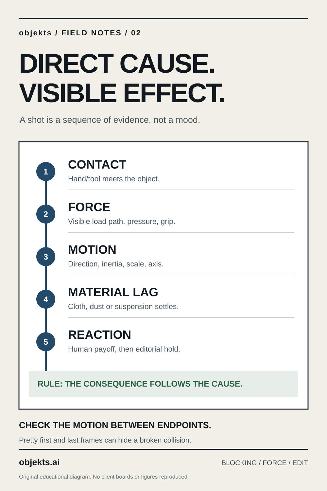

# Stop Prompting “Make It Move”: Physical Causality for Generative Video

*objekts / Production Field Notes · 26 October 2026 · Shot-engineering method*

**For:** directors, AI filmmakers, previs artists and motion engineers. [objekts — cinematic AI/VFX production](https://objekts.ai/en/services/ai-vfx/)

A text-to-video model may produce a plausible surface motion while failing the cause-and-effect chain that makes a shot believable. The arm moves, but the object was never gripped. A heavy load floats without support. The camera reveals a reaction before the triggering action. The prompt has named every material and lens but has not specified **what forces what to move**.

The fix begins as staging and mechanics, before choosing a generator.

## Model the shot as state transitions

Use a compact grammar:

`START STATE → INTENTION/EYELINE → WEIGHT SHIFT → CONTACT → FORCE/MECHANICS → SECONDARY REACTION → PAYOFF → END STATE → EDIT HANDOFF`.

For every transition identify:

1. **Initiator:** limb, tool, motor or environmental force.
2. **Contact geometry:** where pressure enters the object; what supports the weight.
3. **Screen-space direction:** left/right/up/down and motion relative to camera axis.
4. **Temporal order:** what happens first; what is visible when the cut occurs.
5. **Material response:** compression, inertia, delayed motion, dust, cloth or surface deformation.
6. **Conservation check:** the effect cannot arrive before the cause, and mass cannot teleport.

This is not a request for a full physics simulation. It is a director's specification of the visible evidence the shot must contain.

## Example: a suspended cargo pallet

*Illustrative fictional scene, unrelated to any client work.*

**Weak instruction:** “A worker operates a powerful lift and a heavy crate lowers cinematically with realistic physics.”

**Useful shot card:**

- Frame 0: locked-off three-quarter shot. Hoist cable visibly taut, crate suspended 30 cm above the platform. Worker is visible with one hand on a controller.
- Frames 1–8: worker looks to the load and depresses the control; wrist movement is small and readable.
- Frames 9–30: cable remains aligned with load center; the crate descends slowly with the support path visible. Vertical motion precedes compression at contact.
- Frames 31–40: crate contacts platform; suspension load relaxes, loose wrapping settles with a slight delay.
- Frames 41–50: worker's reaction, then hold on the new stable end state.
- Forbidden: crate hovering after release, cable passing through solids, duplicate controllers, unsignaled direction reversal, sudden location change.

**Numbers above are a 25-fps planning example (2.04 seconds for frames 0–50 inclusive).** They are not a generator guarantee or an actual client storyboard. Validate edit duration against real cut boundaries, motion model constraints and physical reference footage.

## One dominant event per short cut

At 25 fps, a 0.80-second shot contains 20 frames. A prompt that asks for “enter, wave, remove jacket, sit, pull gift, smile” in 20 frames is generally staging nonsense. Prioritize one legible cause and a response, then let adjacent shots carry the rest.

If the payoff is a joke, run a silent readability test: mute voiceover and music, show the candidate to an uninformed viewer, ask exactly what changed and why. A beautiful frame that requires a paragraph of explanation fails the dramatic task.

A practical edit matrix:

| Duration | 25-fps frames | Planning priority |
|---|---:|---|
| 0.80s | 20 | Single entrance, trigger or glance |
| 1.20s | 30 | One controlled interaction |
| 1.80s | 45 | Interaction plus visible consequence |
| 3.20s | 80 | Longer behavioral arc if staging supports it |

These are heuristics, not hard limits, and real source frame rates must be measured rather than assumed.

## The camera must remain a physical observer

Write the camera's starting position, height, axis, focal length class, movement and ending frame. A dolly-out can reveal where an object sits; it cannot silently change the space. If the shot requires a pullback from face detail to a landscape reveal, verify that the lens and camera path can express the distance change without morphing the face, objects or geography.

For continuity, record:
- a world anchor (doorway/window/horizon/object);
- which side of the axis the camera remains on;
- screen direction of the actor and key prop;
- motivation of light sources and shadow direction;
- approved start/end stills and cut points.

## Human, fabric and creature interaction

Constrain each material to its own response. Skin creases with expression; clothing follows the actor with delayed folds and gravity; feathers have directional structure; a rigid object maintains topology. If a human face must remain recognizable across an unusual form, the facial proportions, expression timing and substrate anatomy need independent reviews. Never treat a successful full-body video as evidence that identity, fingers and fabric are all correct at close inspection.

## QC requires moving-image evidence

For every candidate, inspect first, middle and last frames **and the transition between them**. A motion may have flawless endpoints but an impossible collision in the center. Check:

- force visible before effect;
- continuous tool/object contact;
- stable perspective, scale and weight;
- anatomy over the entire arc;
- no prop or wardrobe mutation;
- shadow and reflection continuity;
- reaction and edit handoff at the intended time.

If a scene fails causality, don't append more “photorealistic, cinematic, premium” adjectives. Rewrite the mechanical sequence or divide the action across shots.

**Bottom line:** the best video prompt resembles a short engineering-and-directing memo: blocking, cause, time, material response and an end-state that can be cut into the next shot.

*This is transferable production methodology. No proprietary shot boards, client identities or performer likenesses are reproduced.*