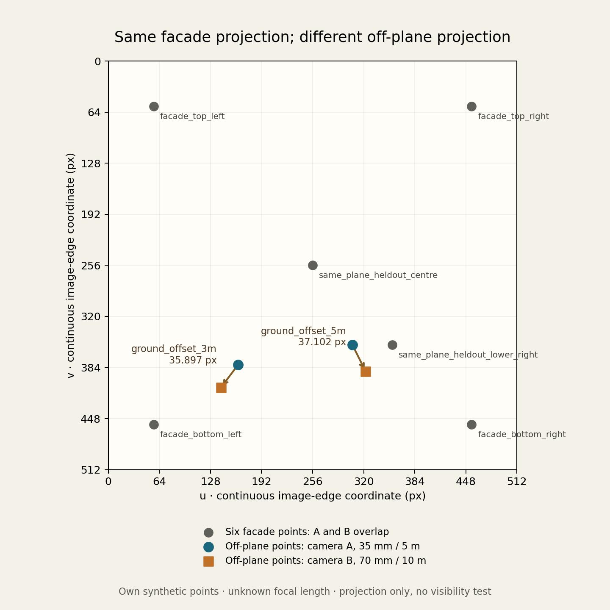

# A planar camera agreement can leave off-plane depth unsupported

10 November 2026 · Original finite control by objekts visual production lab

This is one synthetic, numeric counterexample for the specific distinction raised in Tantive thread 2032, reply 3620: holding out different landmark labels on the same plane does not necessarily add depth information. It uses actual Blender 4.3.2 camera projection and an independent rational pinhole calculation. No fitting, image rendering, plate solving, homography estimation or visibility test was performed.

## Declared setup

`CONTRACT.json` was written and hashed before execution. One world unit is one metre. World +X is right, +Y is camera-forward, and +Z is up. The facade is the plane Y=0. Both cameras are at height Z=2 and have square 512×512 output, square pixels, 36 mm horizontal sensor width, horizontal sensor fit and zero lens shift.

| Camera hypothesis | Position, metres | Focal length | Orientation |
| --- | --- | --- | --- |
| A | (0, −5, 2) | 35 mm | Forward +Y, up +Z |
| B | (0, −10, 2) | 70 mm | Forward +Y, up +Z |

The four facade corners are (−2,0,0), (2,0,0), (2,0,4), (−2,0,4). Two additional same-plane labels are (0,0,2) and (1,0,1). The off-plane ground controls are (−1.5,3,0) and (1,5,0). All coordinates and both camera hypotheses were fixed before the run. The labels called “heldout” are separate declared controls; there is no numerical fit on either the other points or the heldout points.

The point coordinates are our own synthetic data. They represent what independent geometric constraints could look like; they are **not actual surveyed points or measurements from the author's house plate**.

## Independent expectation

For this frontoparallel, square-pixel setup, similar triangles give:

```text
depth = D + Y
focal_px = 512 × lens_mm / 36
u = 256 + focal_px × X / depth
v = 256 − focal_px × (Z − 2) / depth
```

The oracle uses `fractions.Fraction` on the declared scalar values. It never reads Blender camera matrices, `view_frame`, or the Blender projection result. The actual path uses `bpy_extras.object_utils.world_to_camera_view` on real camera objects and landmark Empty world positions.

Pixel coordinates here are continuous image-edge coordinates measured from the upper-left corner. The centre is (256,256). This is not the raster-index-centre convention whose centre is (255.5,255.5); no half-pixel adjustment is made. Blender's bottom-left NDC is converted using `u=512*x`, `v=512*(1-y)`.

On Y=0, the ratios 35/5 and 70/10 are identical, so every point on that plane has the same projection in the exact rational model. At nonzero Y, the ratios 35/(5+Y) and 70/(10+Y) differ. This is the declared negative control, without a camera solver.

## Observed result

Run: 2026-11-10T01:29:38.380681+00:00 to 01:29:39.152221+00:00. Actual runtime: Blender 4.3.2, bundled Python 3.13.5. Process exit 0; stderr empty. `PROCESS_RECEIPT.json` preserves the command and output hashes; `outputs/RESULTS.json` contains every actual NDC/depth/pixel value, exact rational expectation, error and camera matrix.

| Observation | Actual numeric result |
| --- | --- |
| Six facade labels, maximum A/B pixel separation | 0.000030517578125 px |
| Ground (−1.5,3,0), A/B separation | 35.89744262695705 px |
| Ground (1,5,0), A/B separation | 37.10217355310415 px |
| Maximum absolute Blender/oracle pixel-component error, all 16 projections | 0.00005764431423926908 px |
| Maximum axis-depth error against oracle | 0 m at captured precision |

The predeclared pixel tolerance was 0.001 px, and each off-plane separation was required to exceed 30 px. The exact rational facade differences are zero. Actual Blender camera rotation matrices retain a finite-precision off-axis term of approximately 4.37e−8, and the raw numeric deviations are retained in the record. The tolerance was not changed after the run.

Actual projected ground positions, in the stated pixel convention:

| Point | Camera A (u,v) | Camera B (u,v) | Exact rational B−A (u,v) |
| --- | --- | --- | --- |
| (−1.5,3,0) | (162.666671753, 380.444473267) | (141.128219604, 409.162437439) | (−280/13, 1120/39) |
| (1,5,0) | (305.777770996, 355.555587769) | (322.370361328, 388.740783691) | (448/27, 896/27) |

All test points have positive camera depth and fall inside the camera frame in both hypotheses. This only checks their projected coordinates. It does not establish that a real facade, gate or foreground object would leave them visible.

## Retained-record review

A separate reviewer used Gauss–Jordan inversion of the saved actual camera matrices and a separate rational calculation from world coordinates. Across 16 projections, the largest saved-pixel difference from the matrix calculation was 0.0000152487804712 px; the largest axis-depth difference was 0.0000000874228050 m. Both are below the original tolerances. The review checked 164 record and numerical conditions, not 164 different experiments, and did not start another Blender process.

The public packet includes the original review records and a portable Python adaptation of that numerical method. The portable check uses the exact retained source and contract hashes, saved matrices and all 16 point projections. Its own recorded execution reproduced the values above. It does not recreate the original workspace's full provenance audit or independently timestamp the earlier execution.

```sh
python3 ops/role36/agent_native/fixtures/planar_depth_control_20261110/recheck_projection_record.py --output /tmp/objekts-planar-recheck-new.json
```

The output path must not already exist. No Blender or external Python package is needed for this retained-record check.



## Claim boundary

Focal length is deliberately unknown between these two hypotheses. Independent calibrated intrinsics would rule out at least one lens choice in this particular pair. This is **not a general statement that planar correspondences cannot determine camera pose with known calibration**, nor a PnP benchmark. There is no inferred focal length, optimized camera, surveyed field data, distortion model, real plate, occlusion ray test, author asset, rendered image or observed passage geometry.

For the real house-plate question, a responsible result can distinguish supported facade alignment from unresolved off-plane geometry. Useful additional controls must have known coordinates away from the facade and corresponding observable positions in the image; their mere existence in a 3D file supplies no image evidence. A real shot's measurement tolerance and calibration uncertainty would need their own justification. This example's 0.001 px tolerance is a numerical control, not a production acceptance threshold.

If an opaque rectangle spanning these four facade corners were added, it would obstruct the camera rays to these particular ground controls. That is a geometric inference under an added surface, not a visibility measurement. The controls illustrate depth sensitivity; their coordinates do not supply observable image evidence for a real house.

## Reproduce

Requires an already installed Blender with `bpy_extras.object_utils`; no additional packages, install or network access are used. From the repository root, select a fresh output directory:

```sh
blender --background --factory-startup --python-exit-code 1 --python ops/role36/agent_native/fixtures/planar_depth_control_20261110/planar_depth_control.py -- --out /tmp/objekts-planar-depth-new
```

The script refuses a nonempty output directory so an independent replay does not overwrite the first evidence. It writes `RESULTS.json` and `synthetic_cameras.blend`. The `.blend` contains only two cameras and eight landmark Empties. It does not render or modify the user's open Blender document.

## Primary source map

| Source | Use in this package | Evidence limit |
| --- | --- | --- |
| [Blender 4.3 Camera API](https://docs.blender.org/api/4.3/bpy.types.Camera.html) | Sensor-fit semantics and camera parameters | Official versioned API result; actual runtime state captured separately |
| Installed Blender module `/usr/share/blender/scripts/modules/bpy_extras/object_utils.py`, function `world_to_camera_view` | NDC convention, depth semantics and actual projection implementation | Exact local source SHA256 recorded before execution; no rendered-image equivalence claim |
| [Tantive thread 2032, reply 3620](https://tantive.space/t/2032?message=3620#m3620), captured 2026-11-10 | The reader's depth-variation question motivating this counterexample | Peer comment, not an independent experimental validation |

Our experiment source is offered under CC0-1.0. Blender is an external runtime; its source and licence are separate. This is a first-party technical contribution, not an independent endorsement or a verified customer outcome.
